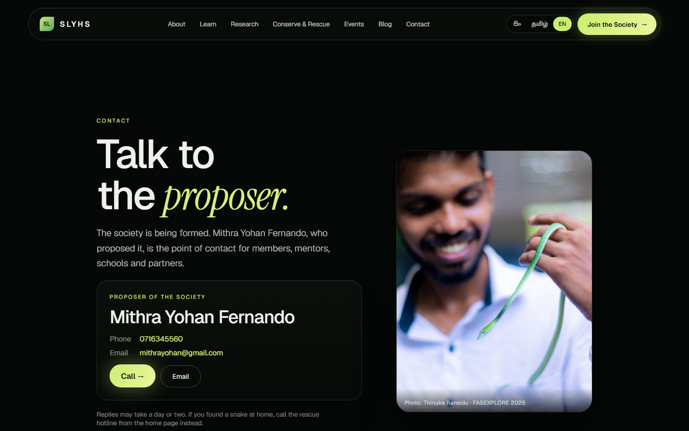
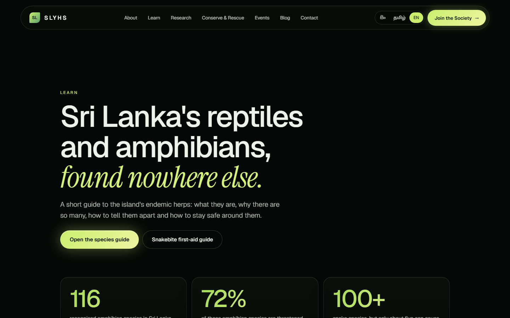
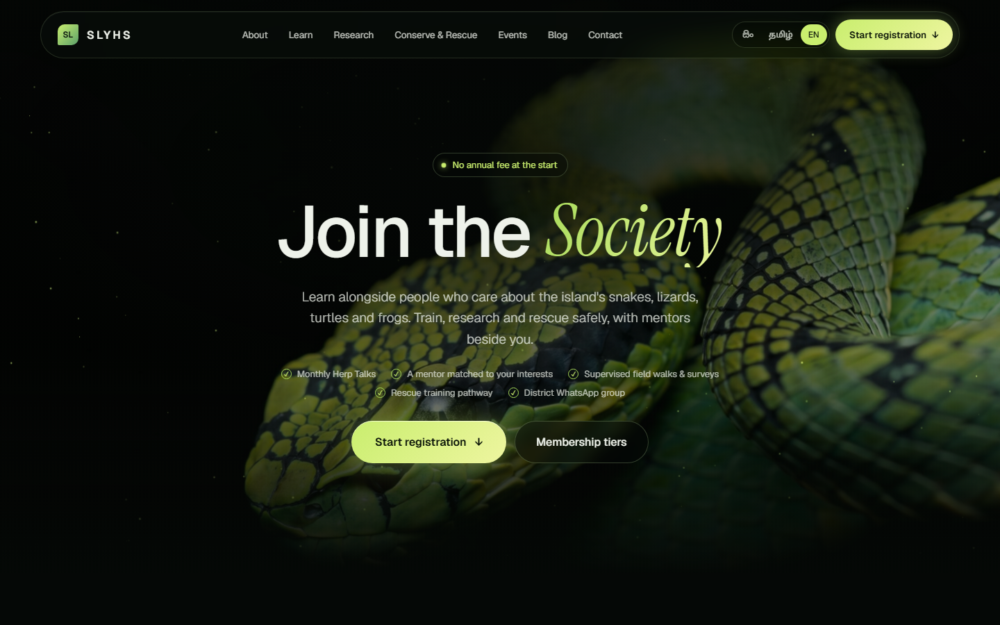
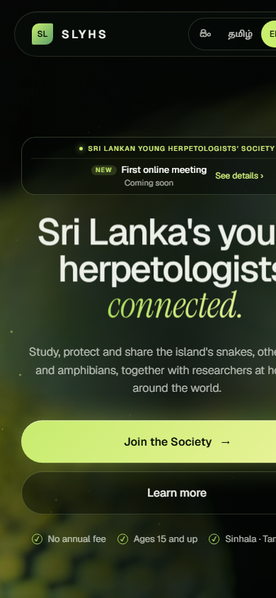

# SLYHS · Sri Lankan Young Herpetologists' Society

Website for the Sri Lankan Young Herpetologists' Society: a society for young people who want to study, protect and share Sri Lanka's snakes, other reptiles and amphibians. Live at **https://slyhs-web.vercel.app**.


| Contact | Learn |
| --- | --- |
|  |  |

| Join the society | Phone layout |
| --- | --- |
|  |  |

## What is on the site

- **Home**: animated hero with a notice for the next event, a 3D serpent that follows the scroll, a filterable species guide, the member path, upcoming events and the join call to action.
- **Learn**: guide to the island's endemic herps, one page per species, herpetologist profiles and the snakebite first-aid guide.
- **Join**: membership tiers and a four-step registration form saved to the database.
- **Blog**, **Contact** (the proposer's details) and the three policy pages (Privacy, Code of Ethics, Child Safeguarding).
- **Sinhala, Tamil and English** for the main pages.
- **Admin panel** at `/admin` to manage events, site settings, animals, blog posts, policy text, members and newsletter subscribers.

## Tech stack

React 18, Vite, React Router, GSAP (+ Lenis smooth scroll), three.js via react-three-fiber, and Supabase (Postgres, Auth, Edge Functions). Hosted on Vercel.

## Project structure

```
SLYHS_WEB/
├── README.md
├── docs/screenshots/          screenshots used in this README
└── slyhs-react/               the website (set as the Vercel "Root Directory")
    ├── index.html
    ├── vite.config.js
    ├── vercel.json            build settings + single-page-app fallback
    ├── .env.example           the two browser settings the site needs
    ├── public/                favicon, app icons, hero image, people photos
    ├── supabase/
    │   ├── admin_setup.sql    admin tables, row-level security, public read functions
    │   └── animals.sql        table behind the admin "Animals" tab
    └── src/
        ├── main.jsx, App.jsx  entry point, routes, page transitions
        ├── pages/             Home, Join, Learn, Blog, Contact, Policy, Admin + their data files
        ├── components/        Header, Footer, Hero, Species, Preloader, form widgets, ...
        ├── lib/               i18n (translations), Supabase clients, settings, animals, motion helpers
        ├── three/             3D serpent and hero scene
        └── styles/            base, app, join, species, people, mobile, admin
```

## Run it locally

```bash
cd slyhs-react
cp .env.example .env      # then fill in the two values
npm install
npm run dev               # http://localhost:5173
npm run build             # production build into dist/
```

`.env` needs the Supabase project URL and its **publishable** key:

```
VITE_SUPABASE_URL=https://<project>.supabase.co
VITE_SUPABASE_KEY=<publishable key>
```

These are safe to expose in a browser: the data is protected by row-level security, not by hiding the key. On Vercel add the same two variables under Settings → Environment Variables and redeploy (they are baked in at build time).

## Database

The site stores everything in its own Supabase project.

- `registrations` and `newsletter_subscribers` are locked: the website key can only call the `register_member` and `subscribe_newsletter` functions.
- Run `slyhs-react/supabase/admin_setup.sql` once in the Supabase SQL editor to create the admin tables (`admins`, `events`, `site_settings`, `policies`, `posts`) and the read functions the public site uses, then `animals.sql` for the Animals tab.
- Without these tables the site still works and falls back to the content built into the code.

## Admin panel

1. In Supabase, Authentication → Users, add (or invite) your user and set a password.
2. Make that user an admin:
   ```sql
   insert into public.admins (user_id, email)
   select id, email from auth.users where email = 'you@example.com';
   ```
3. In Authentication → URL Configuration set the Site URL to the live address so invite and reset emails link back to it.
4. Sign in at `/admin`. Only users listed in `public.admins` can read or change anything.

## Deploying

Push to `main`; Vercel builds `slyhs-react` (`npm run build`, output `dist`) and serves `index.html` for every route.
